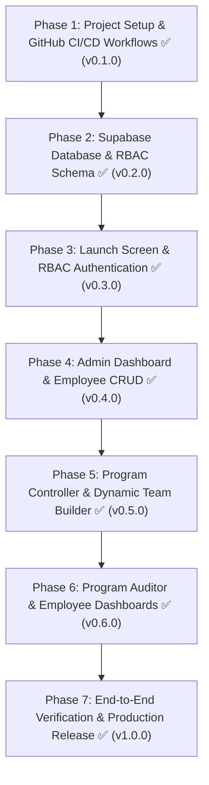

# Marush Mobile Application — Master Implementation Plan

**Marush (Pvt.) Ltd.** is the exclusive sole distributor of **Ceva Animal Health** in Pakistan, specializing in poultry vaccines, hatchery vaccination services, and farm flock monitoring.

This document outlines the end-to-end phased development and delivery plan for the cross-platform Expo React Native application with Supabase RBAC backend, automated GitHub CI/CD, and release pipeline.

---

## 🎨 Brand Design System & Visual Identity
- **Primary Color (Deep Forest Green):** `#004F42`
- **Secondary / Teal (Cyan/Teal):** `#16BAAF`
- **Dark Neutral (Slate Navy):** `#18333b`
- **Accent (Ceva Orange):** `#fe5b2c`
- **Background Light:** `#F8FAFC`
- **Card Background:** `#FFFFFF`
- **Border / Divider:** `#E2E8F0`
- **Typography:** Unna (Headings) & Roboto / Inter (Body)
- **Design Philosophy:** Minimalist, smooth, high-contrast, zero UI clutter.

---

## 🏗️ Phased Implementation Status

---

### Phase 1: Project Setup, Expo Scaffolding & Complete GitHub CI/CD Workflow ✅ *(Completed - v0.1.0)*
- **Git & Remote Repository Setup:** Local git initialized, remote GitHub repository linked under `@muhammadsherazsandila/marush-app`.
- **Expo Scaffolding:** Configured with TypeScript, Native tokens, Toast notifications, SVG assets, and pnpm package management.
- **GitHub Actions Workflows:** `ci.yml` (automated typecheck & export) and `release.yml` (automated releases on tags).

---

### Phase 2: Supabase Architecture & RBAC Backend ✅ *(Completed - v0.2.0)*
- **Data Models:** PostgreSQL tables `profiles`, `programs`, `program_members`, `program_audits` with custom Enums.
- **Security:** Strict Row Level Security (RLS) policies across all roles, helper functions, and triggers.
- **Seed Data:** `seed_demo_data()` routine and dual-mode `dataProvider` (Supabase live queries with in-memory fallback).

---

### Phase 3: Brand Identity, Launch Screen & RBAC Authentication Flow ✅ *(Completed - v0.3.0)*
- **Launch Screen:** Animated splash sequence featuring Marush brand mark & Ceva sole distributor credentials.
- **RBAC Authentication:** Email/Password and Google OAuth 2.0 connected to `dataProvider`.
- **Account Approval Gate:** Unapproved users are held at "Awaiting Admin Approval" with live refresh checks.

---

### Phase 4: Admin Dashboard & Employee Management ✅ *(Completed - v0.4.0)*
- **Overview Tab:** Live KPI metric cards and active field feed.
- **Employee CRUD:** Add, Edit role, and Delete actions with search filter and custom employee codes.
- **Approvals Tab:** One-click review for new registrations and program teams with Auditor assignment.
- **Completed Programs Archive:** Detailed modal for cold-chain, flock size, and quality metrics inspection.

---

### Phase 5: Program Controller Experience & Dynamic Team Allocation ✅ *(Completed - v0.5.0)*
- **Program Initiation Form:** Capture title, location, flock size, and scheduled windows.
- **Intelligent Availability Filter:** Strictly filters and selects only personnel not tied to concurrent active programs.
- **Program Completion Reporting:** Cold-chain log verification, vaccine batch number, dosage, and equipment checks.

---

### Phase 6: Program Auditor & Employee Dashboards ✅ *(Completed - v0.6.0)*
- **Program Auditor Dashboard:** Pending audit inspection queue, 5-point verification checklist, quality scoring (0–100), and remarks sign-off.
- **Employee Field Portal:** Personal attendance history with distinct role badges (`PROGRAM CONTROLLER` vs `TEAM MEMBER`).

---

### Phase 7: End-to-End Verification & Production Release ✅ *(Completed - v1.0.0)*
- **Full-System Verification:** Verified state transitions and data flows across all 4 RBAC roles.
- **Build Quality:** TypeScript typechecking and Expo web production bundle passed with 0 errors.
- **Production Release:** Released under version `v1.0.0` with downloadable production web bundles and automated release notes.
