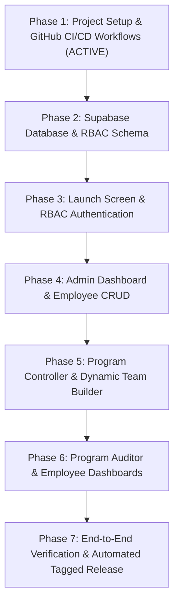

# Marush Mobile Application — Master Implementation Plan

**Marush (Pvt.) Ltd.** is the exclusive sole distributor of **Ceva Animal Health** in Pakistan, specializing in poultry vaccines, hatchery vaccination services, and farm flock monitoring.

This document outlines the end-to-end phased development and delivery plan for the cross-platform Expo React Native application with Supabase RBAC backend, automated GitHub CI/CD, and release pipeline.

---

## 🎨 Brand Design System & Visual Identity
- **Primary Color (Deep Forest Green):** `#004F42`
- **Secondary / Teal (Cyan/Teal):** `#16BAAF`
- **Dark Neutral (Slate Navy):** `#18333b`
- **Accent (Ceva Orange):** `#fe5b2c`
- **Background Light:** `#F8FAFC`
- **Card Background:** `#FFFFFF`
- **Border / Divider:** `#E2E8F0`
- **Typography:** Unna (Headings) & Roboto / Inter (Body)
- **Design Philosophy:** Minimalist, smooth, high-contrast, zero UI clutter.

---

## 🏗️ Phased Implementation Roadmap

---

### Phase 1: Project Setup, Expo Scaffolding & Complete GitHub CI/CD Workflow 🟢 *(In Progress)*
- **Git & Remote Repository Setup:**
  - Initialize local git tracking.
  - Create and link remote GitHub repository using GitHub MCP under `@muhammadsherazsandila`.
- **Expo TypeScript Application Scaffolding:**
  - Initialize Expo project with TypeScript, React Native, Expo Router / Navigation.
  - Integrate Tailwind / NativeWind styling, Lucide icons, React icons, Toast notifications (`react-native-toast-message`), and Framer Motion / Reanimated.
  - Configure asset pipeline (Marush SVG logo).
- **GitHub Actions Workflows (.github/workflows):**
  - `ci.yml`: Continuous Integration workflow for linting, type-checking, and Expo Web/bundle verification on pull requests and pushes to `main`.
  - `release.yml`: Release and Build workflow triggered on git tags (`v*.*.*`), building production bundles/artifacts and creating GitHub Releases with changelog and downloadable artifacts.
- **Superplan Integration:**
  - Tracked tasks and milestones configured via Superplan CLI.

---

### Phase 2: Supabase Architecture & RBAC Backend
- **Data Models:**
  - `profiles`: User account details, role (`admin`, `program_controller`, `employee`, `program_auditor`), status (`pending`, `approved`, `rejected`), contact info.
  - `programs`: Program name, scheduled start/end timestamps, actual start/end timestamps, hatchery/farm flock monitoring details, status (`draft`, `pending_approval`, `active`, `pending_audit`, `completed`, `cancelled`), assigned controller and auditor.
  - `program_members`: Maps available employees to active programs.
  - `program_audits`: Auditor evaluations, checklist items, score, remarks, sign-off timestamp.
- **Row Level Security (RLS) & Policies:**
  - Admins: Full CRUD across all tables.
  - Program Controllers: Can initiate programs, draft teams, submit to admin, and submit completion reports.
  - Program Auditors: Read programs assigned to them and submit audit remarks.
  - Employees: Read-only access to their attended programs and assigned roles.
- **Offline / Mock Mode:**
  - Flexible provider enabling full UI interaction and testing even in development or before Supabase live secrets are injected.

---

### Phase 3: Brand Identity, Launch Screen & RBAC Authentication Flow
- **Launch Screen:**
  - Smooth splash sequence featuring the authentic Marush brand logo (`marush_logo.svg`).
- **RBAC Authentication:**
  - Email/Password and Google OAuth 2.0 login.
  - Registration with full name, role selection, phone, and employee ID.
  - **Account Approval Gate:** Newly created accounts default to `pending` status. Users are directed to a clean "Awaiting Admin Approval" holding screen until approved by an administrator.

---

### Phase 4: Admin Dashboard & Employee Management
- **Dashboard Tabs:**
  - **Overview Tab:** Summary metrics (Total programs completed, currently active programs, pending approval requests, total staff).
  - **Programs Tab:** Master historical record of all completed programs with filter and inspection view.
  - **Active Programs Tab:** Real-time visibility into all currently active programs and assigned personnel.
  - **Employees Tab:** Full CRUD management (add new employee, edit credentials, adjust roles, approve/reject/deactivate).
  - **Pending Approvals Queue:** One-click review for new account registrations and initiated program teams.

---

### Phase 5: Program Controller Experience & Dynamic Team Allocation
- **Program Initiation:**
  - Form to set program title, hatchery / farm flock details, target dates & times.
- **Intelligent Employee Selector:**
  - Real-time availability filter: strictly displays only employees who are currently **available** (not active in any other concurrent program).
- **Team Submission:**
  - Submit drafted team to Admin for approval. Admin approves and assigns a Program Auditor, automatically transitioning the program to `active`.
- **Program Execution & Hand-off:**
  - Controller records completion metrics, vaccine batch/dosage, and submits directly to Program Auditor.

---

### Phase 6: Program Auditor & Employee Dashboards
- **Program Auditor Dashboard:**
  - Inspection queue of ended programs awaiting review.
  - Structured audit evaluation form: verify flock conditions, vaccination procedures, and record auditor remarks.
  - Final approval marks the program as `completed` / `done` and synchronizes with Admin records.
- **Employee Dashboard:**
  - Personal program history: attended programs, dates, and role played (Program Controller vs Team Member).

---

### Phase 7: End-to-End Verification, Version Tagging & Automated GitHub Release
- **Verification:**
  - Cross-platform web and mobile UI testing.
  - Toast notifications and state transitions validated.
- **Release Automation:**
  - Version bump to `v1.0.0`.
  - Tag creation and push triggering GitHub Actions release build.
